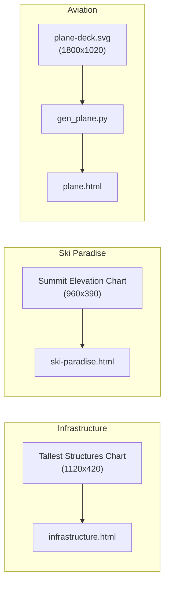

# Site-Wide SVG Architecture & Asset Inventory Report

> **Sovereign Nation of Waikiki** · Design System & Asset Classification Audit  
> **Repository Scope**: 100 HTML pages (46 English, 46 Hungarian, 8 Root/Redirects), 275 standalone `.svg` assets, and 228 inline `<svg>` occurrences.

---

## 1. Executive Summary & Classification Matrix

All vector graphics across the site follow the asset governance model defined in [.agents/rules/AGENTS.md](file:///Volumes/Samsung%20X5%20SSD/Projektek/Site/.agents/rules/AGENTS.md). The site employs a two-dimensional categorization matrix:

1. **Inclusion Method**:
   - **`inline`**: `<svg>` markup embedded directly into the HTML document tree.
   - **`linked`**: Vector files stored in `icons/` or `content/` and referenced via ``.
2. **Creation Mechanism**:
   - **`generated`**: Procedurally computed or injected by Python scripts in `scripts/svg_generators/`.
   - **`fix file`**: Static, canonical vector art or UI icons hand-authored or imported once and never generated dynamically.

```mermaid
flowchart TD
    SVG["Site Vector Assets (SVGs)"]
    
    SVG --> INLINE["Inline SVGs (&lt;svg&gt; in HTML)"]
    SVG --> LINKED["Linked SVGs (&lt;img src='*.svg'&gt;)"]
    
    INLINE --> INL_GEN["Inline, Generated"]
    INLINE --> INL_FIX["Inline, Fix File"]
    
    LINKED --> LNK_GEN["Linked, Generated"]
    LINKED --> LNK_FIX["Linked, Fix File"]
    
    INL_GEN --> CARDS["Card Illustrations (34 cards)"]
    INL_GEN --> CHARTS["Height & Elevation Charts (2 charts)"]
    INL_GEN --> MAPS_INL["Maps (Mobility, Ski Trails, Islands)"]
    INL_GEN --> CUTAWAY["Air Force One Deck Plan"]
    
    INL_FIX --> SHELL_UI["Page Shell UI Icons (Lang, Theme, Wave, To-Top)"]
    INL_FIX --> WA_MAP["Society Master Territory Map"]
    
    LNK_GEN --> LOC_DIAG["Banking, Space, Nature Transects (-en/-hu)"]
    LNK_GEN --> BIOMES["Nature Biomes (15 standalone SVGs)"]
    LNK_GEN --> NA_MAP["Nova Aurelia Archipelago Map"]
    
    LNK_FIX --> HEROES["Hero Panoramas (icons/*/hero-art.svg)"]
    LNK_FIX --> SKYLINE["Nova Aurelia Skyline, Pyramid, Hub"]
    LNK_FIX --> VEHICLES["Rockets (12) & Air Force Planes (4)"]
    LNK_FIX --> MDI["Material Design Icons (211 icons/mdi/)"]
    LNK_FIX --> LOGO["National Coat of Arms (logo.svg)"]
```



### High-Level Statistics

| Asset Category | Total Assets / Occurrences | Inclusion Mode | Creation Type | Localization Status | Primary Generator / Source |
| :--- | :--- | :--- | :--- | :--- | :--- |
| **Card Illustrations** | 34 cards across 4 pages | `inline` | `generated` | Universal / Style-synced | `gen_travel_svgs`, `gen_infrastructure_svgs`, `gen_ski_svgs`, `gen_nova_aurelia_svgs` |
| **Elevation & Height Charts** | 2 comparison charts | `inline` | `generated` | Localized (`-en`, `-hu`) | `gen_infrastructure_svgs`, `gen_ski_svgs` |
| **Aircraft Cutaway Plans** | 1 double-deck cutaway | `inline` | `generated` | Localized (`hu` translated) | `gen_plane.py` (from `icons/planes/plane-deck.svg`) |
| **Geographic & Island Maps** | 6 interactive maps | `inline` & `linked` | `generated` & `fix` | Localized & Fixed | `gen_infrastructure_map`, `gen_ski_maps`, `gen_palm_map`, `gen_world_map`, `gen_chameleon_map` |
| **Sector Visualizations** | 10 diagram files | `linked` | `generated` | Localized (`-en`, `-hu`) | `gen_banking_svgs`, `gen_space_svgs`, `gen_nature_svgs` |
| **Hero Art & Panoramas** | 4 hero files + 3 landmarks | `linked` | `fix file` | Not localized (canonical) | Handcrafted vector art in `icons/*/` |
| **Nature Biomes & Vignettes** | 15 standalone files | `linked` | `generated` | Not localized | `gen_nature_svgs.py` (in `icons/nature/`) |
| **Aerospace & Aviation Topviews** | 16 technical files | `linked` | `fix file` | Not localized (telemetry) | `icons/rockets/` (12), `icons/planes/` (4) |
| **Material Design System Icons** | 211 standalone files | `linked` | `fix file` | Universal UI icons | `icons/mdi/*.svg` |
| **National Coat of Arms** | 1 standalone file (138 uses) | `linked` | `fix file` | Universal brand identity | `icons/logo.svg` |
| **Page Shell UI Controls** | 4 inline SVGs per page (184 total) | `inline` | `fix file` | Universal page template | Embedded in HTML page header, navbar & footer |

---

## 2. Detailed Category Breakdown

### 2.1 Card Illustrations (`inline, generated`)

Card illustrations are native `<svg class="ill">` elements rendered within `<div class="hotel-art">`, `<div class="building-art">`, or `<div class="city-ill">` containers inside card grids. They adjust seamlessly to dark and light modes using design-system CSS fill and stroke classes.

| Page | Cards Count | Container Class | Generator Script | Description |
| :--- | :--- | :--- | :--- | :--- |
| [en/travel-guide.html](file:///Volumes/Samsung%20X5%20SSD/Projektek/Site/en/travel-guide.html) / [hu/travel-guide.html](file:///Volumes/Samsung%20X5%20SSD/Projektek/Site/hu/travel-guide.html) | 15 | `.hotel-art` | [gen_travel_svgs.py](file:///Volumes/Samsung%20X5%20SSD/Projektek/Site/scripts/svg_generators/gen_travel_svgs.py) | 15 Luxury Hotel and Sanctuary cards (Hotel President, Hotel Atlantis, Hotel Khalifa, Starlight Grand, Royal Towers Residences, Paradise Islands Water Villas, Ski Paradise Chalets, Amazonia Canopy Lodge, Copacabana Imperial Palace, Aurelia Cloud Suites, Laguna Azul Coral Resort, Monte Rosa Sky Observatory, Solaris Marina and Yacht Club, Amazonia Floating River Palace, Grand Riviera Palace). |
| [en/infrastructure.html](file:///Volumes/Samsung%20X5%20SSD/Projektek/Site/en/infrastructure.html) / [hu/infrastructure.html](file:///Volumes/Samsung%20X5%20SSD/Projektek/Site/hu/infrastructure.html) | 10 | `.building-art` | [gen_infrastructure_svgs.py](file:///Volumes/Samsung%20X5%20SSD/Projektek/Site/scripts/svg_generators/gen_infrastructure_svgs.py) | 10 Megaproject Architecture & Transport cards (Sky City 956m, Princess Tower 720m, Commercial Center 650m, Hotel Atlantis 600m, Royal Clock Tower 580m, Infinity Tower 480m, Mega Pyramid City 450m, Miapolis 1000m, Ducal Palace, Nova Aurelia Airport). |
| [en/ski-paradise.html](file:///Volumes/Samsung%20X5%20SSD/Projektek/Site/en/ski-paradise.html) / [hu/ski-paradise.html](file:///Volumes/Samsung%20X5%20SSD/Projektek/Site/hu/ski-paradise.html) | 5 | `.hotel-art` | [gen_ski_svgs.py](file:///Volumes/Samsung%20X5%20SSD/Projektek/Site/scripts/svg_generators/gen_ski_svgs.py) | 5 Alpine Resort cards (Pico Soberano Grand Alpine Resort, Condor Glacier Panorama Lodge, Monte Rosa Sky Observatory, Haiti Glacier Crown Eco-Resort, Pico Duarte Alpine & Thermal Spa). |
| [en/nova-aurelia.html](file:///Volumes/Samsung%20X5%20SSD/Projektek/Site/en/nova-aurelia.html) / [hu/nova-aurelia.html](file:///Volumes/Samsung%20X5%20SSD/Projektek/Site/hu/nova-aurelia.html) | 4 | `.district-art` / `data-city-svg` | [gen_nova_aurelia_svgs.py](file:///Volumes/Samsung%20X5%20SSD/Projektek/Site/scripts/svg_generators/gen_nova_aurelia_svgs.py) | 4 Imperial City District cards (Marina District, Imperial Boulevard, Aerotropolis, Night Lagoon). |

---

### 2.2 Technical Charts & Deck Plans (`inline, generated`)

Technical diagrams and architectural comparison charts present structured telemetry with localized typographic labels and reference heights.



1. **Tallest Structures Height Comparison Chart** ([infrastructure.html](file:///Volumes/Samsung%20X5%20SSD/Projektek/Site/en/infrastructure.html#L457)):
   - **Dimensions**: `viewBox="0 0 1120 420"`, `class="ill height-chart"`
   - **Creation**: Generated by [gen_infrastructure_svgs.py](file:///Volumes/Samsung%20X5%20SSD/Projektek/Site/scripts/svg_generators/gen_infrastructure_svgs.py) (`build_infra_height_chart`).
   - **Localization**: Localized reference labels (`reference` vs `viszonyítás`), structure names (`Eiffel Tower` vs `Eiffel-torony`, `Burj Khalifa` vs `Burdzs Kalifa`, `Mega Pyramid` vs `Mega Piramis`), and thousand separators (`~1,000 m` vs `~1000 m`).
2. **Summit Elevation Comparison Chart** ([ski-paradise.html](file:///Volumes/Samsung%20X5%20SSD/Projektek/Site/en/ski-paradise.html#L380)):
   - **Dimensions**: `viewBox="0 0 960 390"`, `class="ill height-chart"`
   - **Creation**: Generated by [gen_ski_svgs.py](file:///Volumes/Samsung%20X5%20SSD/Projektek/Site/scripts/svg_generators/gen_ski_svgs.py) (`build_ski_height_chart`).
   - **Localization**: Localized mountain ranges (`Waikiki Andes` vs `Waikiki Andok`, `Switzerland (Ref.)` vs `Svájc (Ref.)`), and elevation ticks (`5,000 m` vs `5000 m`).
3. **Boeing 7107-B Air Force One 2-Deck Cutaway Plan** ([plane.html](file:///Volumes/Samsung%20X5%20SSD/Projektek/Site/en/plane.html#L254)):
   - **Dimensions**: `viewBox="0 0 1800 1020"`, `class="ill deckplan-ill"`
   - **Creation**: Hand-authored master vector template in [icons/planes/plane-deck.svg](file:///Volumes/Samsung%20X5%20SSD/Projektek/Site/icons/planes/plane-deck.svg). Processed and injected by [gen_plane.py](file:///Volumes/Samsung%20X5%20SSD/Projektek/Site/scripts/svg_generators/gen_plane.py), which performs automated text replacement for Hungarian room labels and technical specs.

---

### 2.3 Maps & Spatial Infrastructure

Maps combine vector geography, transport routes, and interactive pulse hotspots:

| Map Visual | Target Location | Inclusion Mode | Creation Type | Source / Script | Technical Characteristics |
| :--- | :--- | :--- | :--- | :--- | :--- |
| **Mobility Transit Map** | `infrastructure.html#mobility` | `inline` | `generated` | [gen_infrastructure_map.py](file:///Volumes/Samsung%20X5%20SSD/Projektek/Site/scripts/svg_generators/gen_infrastructure_map.py) | `1800x650`, extracts geospatial boundaries from `content/Maps/*.svg`, computes high-speed rail, maglev, and ferry lines. |
| **Palm Island Map** | `infrastructure.html#islands` | `inline` | `generated` | [gen_palm_map.py](file:///Volumes/Samsung%20X5%20SSD/Projektek/Site/scripts/svg_generators/gen_palm_map.py) | `1200x700`, procedurally generates crescent breakwater, trunk, 16 fronds, and interactive numbered hotspots. |
| **World Islands Map** | `infrastructure.html#islands` | `inline` | `generated` | [gen_world_map.py](file:///Volumes/Samsung%20X5%20SSD/Projektek/Site/scripts/svg_generators/gen_world_map.py) | `1200x700`, multi-harmonic Chaikin-smoothed dredged sandbanks forming the 7 continental archipelagoes. |
| **Chameleon Island Map** | `infrastructure.html#islands` | `inline` | `generated` | [gen_chameleon_map.py](file:///Volumes/Samsung%20X5%20SSD/Projektek/Site/scripts/svg_generators/gen_chameleon_map.py) | `1200x700`, organic reptile silhouette island with orbital eye, prehensile tail yacht lagoon, and dorsal luxury villas. |
| **Andes Ski Trail Map** | `ski-paradise.html#trail-maps` | `inline` & `linked` | `generated` | [gen_ski_maps.py](file:///Volumes/Samsung%20X5%20SSD/Projektek/Site/scripts/svg_generators/gen_ski_maps.py) | `1200x700`, panoramic mountain relief with green/blue/red/black ski slopes, gondola lifts, and mountain chalets. Standalone file in `icons/ski/andes-map.svg`. |
| **Haiti Ski Trail Map** | `ski-paradise.html#trail-maps` | `inline` & `linked` | `generated` | [gen_ski_maps.py](file:///Volumes/Samsung%20X5%20SSD/Projektek/Site/scripts/svg_generators/gen_ski_maps.py) | `1200x700`, tropical Caribbean high-altitude ski slopes with ocean vistas and cloud inversions. Standalone file in `icons/ski/haiti-map.svg`. |
| **Nova Aurelia Masterplan** | `nova-aurelia.html#masterplan` | `linked` | `generated` | [gen_nova_aurelia_svgs.py](file:///Volumes/Samsung%20X5%20SSD/Projektek/Site/scripts/svg_generators/gen_nova_aurelia_svgs.py) | `1100x600`, archipelago city masterplan linked via ``. |
| **Sovereign Territory Map** | `society.html#territory` | `inline` | `fix file` | Handcrafted SVG markup in HTML | `1800x1020`, nationwide geographic atlas showing Caribbean and South American territories, EEZ boundaries, and shipping corridors. |

---

### 2.4 Other Localized Sector Visualizations (`linked, generated`)

Complex sector infographics are generated as separate `-en.svg` and `-hu.svg` vector files in `icons/` and linked via native `` elements:

| Topic | File Pair | Display Page | Generator Script | Content Description |
| :--- | :--- | :--- | :--- | :--- |
| **Banking Tripartite Network** | `icons/banking/network-en.svg`<br/>`icons/banking/network-hu.svg` | [banking-system.html](file:///Volumes/Samsung%20X5%20SSD/Projektek/Site/en/banking-system.html) | [gen_banking_svgs.py](file:///Volumes/Samsung%20X5%20SSD/Projektek/Site/scripts/svg_generators/gen_banking_svgs.py) | Three-tier financial architecture: Central Bank, Sovereign Wealth Fund, and Commercial Settlement Grid. |
| **Sovereign Rate Corridor** | `icons/banking/rates-en.svg`<br/>`icons/banking/rates-hu.svg` | [banking-system.html](file:///Volumes/Samsung%20X5%20SSD/Projektek/Site/en/banking-system.html) | [gen_banking_svgs.py](file:///Volumes/Samsung%20X5%20SSD/Projektek/Site/scripts/svg_generators/gen_banking_svgs.py) | Policy rate corridor, liquidity bounds, overnight repo rates, and reserve tranche bands. |
| **Interplanetary Space Station** | `icons/space/station-en.svg`<br/>`icons/space/station-hu.svg` | [space-research.html](file:///Volumes/Samsung%20X5%20SSD/Projektek/Site/en/space-research.html) | [gen_space_svgs.py](file:///Volumes/Samsung%20X5%20SSD/Projektek/Site/scripts/svg_generators/gen_space_svgs.py) | Orbital Deep Space Gateway: solar arrays, centrifuge habitation rings, and docking nodes. |
| **Interplanetary Corridor** | `icons/space/corridor-en.svg`<br/>`icons/space/corridor-hu.svg` | [space-research.html](file:///Volumes/Samsung%20X5%20SSD/Projektek/Site/en/space-research.html) | [gen_space_svgs.py](file:///Volumes/Samsung%20X5%20SSD/Projektek/Site/scripts/svg_generators/gen_space_svgs.py) | Orbital trajectory transfer ellipses, Lagrange points, and Lunar/Mars transit corridors. |
| **Sea-to-Summit Biome Transect**| `icons/nature/transect-en.svg`<br/>`icons/nature/transect-hu.svg` | [nature.html](file:///Volumes/Samsung%20X5%20SSD/Projektek/Site/en/nature.html) | [gen_nature_svgs.py](file:///Volumes/Samsung%20X5%20SSD/Projektek/Site/scripts/svg_generators/gen_nature_svgs.py) | Elevation cross-section showing 8 ecological biomes from Caribbean coral reefs to Andean glaciated peaks. |

---

### 2.5 Static Visual Identity & Architecture (`linked, not generated`)

Fixed standalone vector files stored permanently in `icons/` and referenced via `` tags:

1. **Hero Art Panoramas** (Standardized to pure `viewBox="0 0 640 480"` with `rx="40"` outer boundary corner rounding clipPaths):
   - [icons/infrastructure/hero-art.svg](file:///Volumes/Samsung%20X5%20SSD/Projektek/Site/icons/infrastructure/hero-art.svg): Nova Aurelia bayfront panorama with Mega Pyramid, supertall skyline, offshore wind farm, and maglev railway.
   - [icons/travel/hero-art.svg](file:///Volumes/Samsung%20X5%20SSD/Projektek/Site/icons/travel/hero-art.svg): Tropical lagoon resort with overwater bungalows, superyacht marina, and coconut palms.
   - [icons/ski/hero-art.svg](file:///Volumes/Samsung%20X5%20SSD/Projektek/Site/icons/ski/hero-art.svg): Alpine ski mountain panorama with animated CSS cableway gondola motion.
   - [icons/nova-aurelia/hero-art.svg](file:///Volumes/Samsung%20X5%20SSD/Projektek/Site/icons/nova-aurelia/hero-art.svg): Imperial capital metropolis waterfront at sunset.
2. **Nova Aurelia Landmark Panoramas**:
   - [icons/nova-aurelia/skyline.svg](file:///Volumes/Samsung%20X5%20SSD/Projektek/Site/icons/nova-aurelia/skyline.svg): Metropolis skyline panorama (1600x600).
   - [icons/nova-aurelia/pyramid.svg](file:///Volumes/Samsung%20X5%20SSD/Projektek/Site/icons/nova-aurelia/pyramid.svg): Monumental 450m Arcology Mega Pyramid (1200x700).
   - [icons/nova-aurelia/undersea-hub.svg](file:///Volumes/Samsung%20X5%20SSD/Projektek/Site/icons/nova-aurelia/undersea-hub.svg): Submerged transit and oceanographic hub (1200x700).
3. **Nature Biomes & Vignettes** ([icons/nature/](file:///Volumes/Samsung%20X5%20SSD/Projektek/Site/icons/nature/)):
   - 15 standalone SVG files representing specific national ecosystems: `reef.svg`, `rainforest.svg`, `highlands.svg`, `mogotes.svg`, `enriquillo.svg`, `pantanal.svg`, `cerrado.svg`, `lencois.svg`, `caatinga.svg`, `bluehole.svg`, `tepui.svg`, `cataracts.svg`, `elnicho.svg`, `chapada.svg`, `anavilhanas.svg`.
4. **Aerospace Launch Vehicles** ([icons/rockets/](file:///Volumes/Samsung%20X5%20SSD/Projektek/Site/icons/rockets/)):
   - 12 technical rocket silhouettes: `rocket-bfr.svg`, `rocket-delta-3a.svg`, `rocket-delta-3b.svg`, `rocket-delta-4.svg`, `rocket-falcon-heavy.svg`, `rocket-falcon.svg`, `rocket-saturn-nova.svg`, `rocket-saturn-x.svg`, `rocket-shuttle-v2.svg`, `rocket-shuttle.svg`, `rocket-vulcan.svg`, `rocket-ariane.svg`.
5. **Aviation Topviews** ([icons/planes/](file:///Volumes/Samsung%20X5%20SSD/Projektek/Site/icons/planes/)):
   - 4 aircraft wireframes: `plane-af1.svg` (Boeing 7107-B), `plane-concorde.svg` (Lockheed Martin Concorde V2), `plane-747.svg` (Boeing 747-8I), `plane-777.svg` (Boeing 777-200 ER).
6. **Material Design Icons (MDI)** ([icons/mdi/](file:///Volumes/Samsung%20X5%20SSD/Projektek/Site/icons/mdi/)):
   - 211 pure vector icons (24x24) providing visual cues across metadata tags, specs, navigation, and feature lists.
7. **National Brand Identity**:
   - [icons/logo.svg](file:///Volumes/Samsung%20X5%20SSD/Projektek/Site/icons/logo.svg): Royal Coat of Arms of the Sovereign Nation of Waikiki, embedded across all page headers and footers.

---

### 2.6 Page Shell Global UI Icons (`inline, fix file`)

Every HTML document on the site includes 4 inline SVGs providing universal UI navigation and theme control:

```html
<!-- 1. Language Toggle Icon in Navbar -->
<a class="lang-pill" href="../hu/page.html" hreflang="hu" lang="hu" aria-label="Magyar nyelv">
    <svg viewBox="0 0 24 24" fill="none" stroke="currentColor" stroke-width="1.6" aria-hidden="true">
        <path d="M12.87 15.07l-2.54-2.51.03-.08c1.74-1.94 2.98-4.17 3.71-6.48H17V4h-7V2H8v2H1v2h11.17C11.5 7.92 10.44 9.75 9 11.35 8.07 10.32 7.3 9.19 6.69 8h-2c.73 1.63 1.73 3.17 2.98 4.56l-5.09 5.02L4 19l5-5 3.11 3.11.76-2.04zM18.5 10h-2L12 22h2l1.12-3h4.75L21 22h2l-4.5-12zm-2.62 7l1.62-4.33L19.12 17h-3.24z" fill="currentColor"/>
    </svg>HU
</a>

<!-- 2. Dark/Light Theme Engine Toggle -->
<button class="icon-btn theme-toggle" type="button" data-theme-toggle aria-label="Toggle theme">
    <svg class="theme-icon" viewBox="0 0 24 24" aria-hidden="true">
        <path class="sun" d="M12 7c-2.76 0-5 2.24-5 5s2.24 5 5 5 5-2.24 5-5-2.24-5-5-5zM2 13h2c.55 0 1-.45 1-1s-.45-1-1-1H2c-.55 0-1 .45-1 1s.45 1 1 1zm18 0h2c.55 0 1-.45 1-1s-.45-1-1-1h-2c-.55 0-1 .45-1 1s.45 1 1 1zM11 2v2c0 .55.45 1 1 1s1-.45 1-1V2c0-.55-.45-1-1-1s-1 .45-1 1zm0 18v2c0 .55.45 1 1 1s1-.45 1-1v-2c0-.55-.45-1-1-1s-1 .45-1 1zM5.99 4.58c-.39-.39-1.03-.39-1.41 0s-.39 1.03 0 1.41l1.06 1.06c.39.39 1.03.39 1.41 0s.39-1.03 0-1.41L5.99 4.58zm12.37 12.37c-.39-.39-1.03-.39-1.41 0s-.39 1.03 0 1.41l1.06 1.06c.39.39 1.03.39 1.41 0s.39-1.03 0-1.41l-1.06-1.06zm1.06-10.96c.39-.39.39-1.03 0-1.41s-1.03-.39-1.41 0l-1.06 1.06c-.39.39-.39 1.03 0 1.41s1.03.39 1.41 0l1.06-1.06zM7.05 18.36l-1.06 1.06c-.39.39-.39 1.03 0 1.41s1.03.39 1.41 0l1.06-1.06c.39-.39.39-1.03 0-1.41s-1.03-.39-1.41 0z" fill="currentColor"/>
        <path class="moon" d="M12.3 2a10 10 0 0 0-1.9 20 10 10 0 0 0 9.8-8.1 1 1 0 0 0-1.2-1.2 8 8 0 0 1-5.6-1.9 8 8 0 0 1-2.3-6.9 1 1 0 0 0-1.2-1.2A10 10 0 0 0 12.3 2z" fill="currentColor"/>
    </svg>
</button>

<!-- 3. Site Footer Wave Vector Divider -->
<footer class="site-footer">
    <div class="footer-wave-wrap" aria-hidden="true">
        <svg class="footer-wave" viewBox="0 0 1440 90" preserveAspectRatio="none" aria-hidden="true">
            <path d="M0,45 C240,85 480,5 720,45 C960,85 1200,5 1440,45 L1440,90 L0,90 Z"/>
        </svg>
    </div>
</footer>

<!-- 4. Scroll-to-Top Floating Action Button -->
<button class="to-top" type="button" aria-label="Back to top" data-to-top>
    <svg viewBox="0 0 54 54" aria-hidden="true">
        <circle cx="27" cy="27" r="23" fill="none" stroke="currentColor" stroke-width="3" stroke-dasharray="144.5" stroke-dashoffset="144.5"/>
        <path d="M27 34V20M20 27l7-7 7 7" fill="none" stroke="currentColor" stroke-width="3" stroke-linecap="round" stroke-linejoin="round"/>
    </svg>
</button>
```

---

## 3. SVG Illustration Dimensions, ViewBox & Aspect Ratio Specifications

A core engineering principle of the Sovereign Nation of Waikiki design system is **resolution-independent intrinsic vector geometry**. All illustration SVGs across the repository adhere to strict dimensional profiles, aspect ratios, and container scaling rules.

### 3.1 Intrinsic Sizing Architecture & The Pure `viewBox` Standard

Under the W3C SVG specification, vector graphics achieve maximum fluid responsiveness when explicit `width` and `height` attributes on the root `<svg>` tag are completely omitted in favor of a normalized `viewBox="minX minY width height"`.

1. **Fluid Responsive Scaling**:
   - Omitting root `width` and `height` prevents rigid pixel-locking and eliminates inline attribute clashes with CSS layout engines (`flexbox`, CSS Grid, `clamp()`, and container queries).
   - The browser automatically calculates the intrinsic aspect ratio from the `viewBox` coordinates ($W / H$) and effortlessly scales the graphic to fit its host container.
2. **Elimination of Cumulative Layout Shift (CLS)**:
   - For linked vector images (``), dimensional reservation is shifted entirely to the **HTML markup layer**:
     ```html
     
     ```
   - The browser calculates the element aspect ratio box immediately during DOM and CSSOM layout construction before network assets arrive, completely eliminating layout jumps and CLS degradation while leaving the SVG file pure and fluid.
3. **Container-Governed Inline Sizing**:
   - For inline `<svg>` elements embedded in card grids and sections, wrapper elements enforce explicit aspect ratios (e.g. `.hotel-art { aspect-ratio: 16 / 10; }`), and child SVGs expand automatically via `.ill { width: 100%; height: 100%; display: block; }`.

---

### 3.2 Master Dimensions, ViewBox & Aspect Ratio Specification Matrix

The following table provides the exhaustive dimensional catalog for every vector asset and illustration family across the site:

| Asset Classification & Purpose | File Path or Target Location | Canonical `viewBox` | Aspect Ratio | Display Size / CSS Sizing Rule | Border Radius / Corner Clip | Inclusion & Generation |
| :--- | :--- | :--- | :--- | :--- | :--- | :--- |
| **Hero Art Panoramas** | `icons/travel/hero-art.svg`<br/>`icons/infrastructure/hero-art.svg`<br/>`icons/ski/hero-art.svg`<br/>`icons/nova-aurelia/hero-art.svg` | `0 0 640 480` | `4:3` (1.333:1) | Desktop (>1920px): `min(46vw, 720px)`<br/>Responsive (≤1920px): `min(100%, 560px)`<br/>HTML tag: `width="640" height="480"` | `rx="40"` outer boundary `<clipPath>` on all 4 corners | `linked, fix file` (Ski, Travel, Infra)<br/>`linked, fix file` (Nova Aurelia) |
| **Hotel, Sanctuary & Resort Cards** | 30 cards in [travel-guide.html](file:///Volumes/Samsung%20X5%20SSD/Projektek/Site/en/travel-guide.html), [infrastructure.html](file:///Volumes/Samsung%20X5%20SSD/Projektek/Site/en/infrastructure.html), [ski-paradise.html](file:///Volumes/Samsung%20X5%20SSD/Projektek/Site/en/ski-paradise.html) | `0 0 320 200` | `16:10` (8:5, 1.600:1) | Container: `.hotel-art`, `.building-art`<br/>CSS: `aspect-ratio: 16 / 10; width: 100%;`<br/>Child: `.ill { width: 100%; height: 100%; }`<br/>Hover: `transform: scale(1.05);` | Card container `border-radius: var(--radius-l)` (16px / 20px) | `inline, generated` |
| **Imperial District Cards** | 4 district cards in [nova-aurelia.html](file:///Volumes/Samsung%20X5%20SSD/Projektek/Site/en/nova-aurelia.html) & `icons/nova-aurelia/*.svg` | `0 0 640 420` | `32:21` (16:10.5, ~1.524:1) | Container: `.district-art`<br/>Child: `.city-ill { width: 100%; height: auto; }` | Card container `border-radius: var(--radius-l)` | `inline, generated` & `linked, fix file` |
| **Tallest Structures Chart** | [infrastructure.html#skyscrapers](file:///Volumes/Samsung%20X5%20SSD/Projektek/Site/en/infrastructure.html#L457) | `0 0 1120 420` | `8:3` (2.667:1) | Container: `.infra-chart-card`<br/>CSS: `.height-chart { width: 100%; max-width: 1120px; }`<br/>Dynamic bar animations: `scaleY()` | Card container `border-radius: var(--radius-xl)` | `inline, generated` |
| **Summit Elevation Chart** | [ski-paradise.html#elevation](file:///Volumes/Samsung%20X5%20SSD/Projektek/Site/en/ski-paradise.html#L380) | `0 0 960 390` | `32:13` (~2.462:1) | Container: `.ski-chart-card`<br/>CSS: `.height-chart { width: 100%; max-width: 960px; }` | Card container `border-radius: var(--radius-xl)` | `inline, generated` |
| **Double-Deck Cutaway Plan** | [plane.html#deckplan](file:///Volumes/Samsung%20X5%20SSD/Projektek/Site/en/plane.html#L254)<br/>`icons/planes/plane-deck.svg` | `0 0 1800 1020` | `30:17` (~1.765:1) | Container: `.deckplan-container`<br/>CSS: `.deckplan-ill { width: 100%; height: auto; }` | Card container `border-radius: var(--radius-xl)` | `inline, generated` (from fix template) |
| **Mobility Transit Map** | [infrastructure.html#mobility](file:///Volumes/Samsung%20X5%20SSD/Projektek/Site/en/infrastructure.html#L140) | `0 0 1800 650` | `36:13` (~2.769:1) | Ultra-wide panoramic transport map<br/>CSS: `.ill { width: 100%; height: auto; }` | Section container clipping | `inline, generated` |
| **Artificial Island Maps** | Palm, World, Chameleon in [infrastructure.html#islands](file:///Volumes/Samsung%20X5%20SSD/Projektek/Site/en/infrastructure.html#L300) | `0 0 1200 700` | `12:7` (~1.714:1) | Container: `.island-map-card`<br/>CSS: `.ill { width: 100%; height: auto; }` | Card container `border-radius: var(--radius-xl)` | `inline, generated` |
| **Alpine Ski Trail Maps** | Andes & Haiti maps in [ski-paradise.html#trail-maps](file:///Volumes/Samsung%20X5%20SSD/Projektek/Site/en/ski-paradise.html#L210)<br/>`icons/ski/andes-map.svg`, `haiti-map.svg` | `0 0 1200 700` | `12:7` (~1.714:1) | Container: `.ski-trail-card`<br/>CSS: `.ill { width: 100%; height: auto; }` | Card container `border-radius: var(--radius-xl)` | `inline & linked, generated` |
| **Archipelago Masterplan** | [nova-aurelia.html#masterplan](file:///Volumes/Samsung%20X5%20SSD/Projektek/Site/en/nova-aurelia.html)<br/>`icons/nova-aurelia/archipelago-map.svg` | `0 0 1100 600` | `11:6` (~1.833:1) | Linked via ``<br/>HTML tag: `width="1100" height="600"` | Masterplan card container rounded | `linked, generated` |
| **Sovereign Territory Map** | [society.html#territory](file:///Volumes/Samsung%20X5%20SSD/Projektek/Site/en/society.html) | `0 0 1800 1020` | `30:17` (~1.765:1) | National geographic territorial atlas<br/>CSS: `width: 100%; height: auto;` | Map frame wrapper rounded | `inline, fix file` |
| **Banking Network Diagram** | `icons/banking/network-en.svg`<br/>`icons/banking/network-hu.svg` | `0 0 1160 520` | `29:13` (~2.231:1) | Linked via ``<br/>HTML tag: `width="1160" height="520"` | Inner card frame `border-radius: var(--radius-xl)` | `linked, generated` |
| **Sovereign Rate Corridor** | `icons/banking/rates-en.svg`<br/>`icons/banking/rates-hu.svg` | `0 0 1160 440` | `29:11` (~2.636:1) | Linked via ``<br/>HTML tag: `width="1160" height="440"` | Inner card frame `border-radius: var(--radius-xl)` | `linked, generated` |
| **Deep Space Station** | `icons/space/station-en.svg`<br/>`icons/space/station-hu.svg` | `0 0 1160 520` | `29:13` (~2.231:1) | Linked via ``<br/>HTML tag: `width="1160" height="520"` | Inner card frame `border-radius: var(--radius-xl)` | `linked, generated` |
| **Interplanetary Corridor** | `icons/space/corridor-en.svg`<br/>`icons/space/corridor-hu.svg` | `0 0 1160 480` | `29:12` (~2.417:1) | Linked via ``<br/>HTML tag: `width="1160" height="480"` | Inner card frame `border-radius: var(--radius-xl)` | `linked, generated` |
| **Sea-to-Summit Transects** | `icons/nature/transect-en.svg`<br/>`icons/nature/transect-hu.svg` | `0 0 1600 600` | `8:3` (2.667:1) | Linked via ``<br/>HTML tag: `width="1600" height="600"` | Section wrapper rounded | `linked, generated` |
| **Standard Biome Vignettes** | 12 files in `icons/nature/` (`anavilhanas`, `bluehole`, `caatinga`, `cataracts`, `cerrado`, `chapada`, `elnicho`, `enriquillo`, `lencois`, `mogotes`, `pantanal`, `tepui`) | `0 0 480 300` | `8:5` (16:10, 1.600:1) | Linked via ``<br/>HTML tag: `width="480" height="300"`<br/>Grid card thumbnail | Card container `border-radius: var(--radius-m)` | `linked, generated` |
| **Panoramic Biome Landscapes** | `icons/nature/highlands.svg`<br/>`icons/nature/reef.svg`<br/>`icons/nature/rainforest.svg` | Highlands: `0 0 1200 700`<br/>Reef / Rainforest: `0 0 1200 720` | `12:7` (~1.714:1)<br/>`5:3` (1.667:1) | Linked via ``<br/>Wide feature section illustration | Section container rounded | `linked, generated` |
| **Nova Aurelia Landmarks** | `icons/nova-aurelia/skyline.svg`<br/>`icons/nova-aurelia/pyramid.svg`<br/>`icons/nova-aurelia/undersea-hub.svg` | Skyline: `0 0 1600 600`<br/>Pyramid / Hub: `0 0 1200 700` | `8:3` (2.667:1)<br/>`12:7` (~1.714:1) | Linked via ``<br/>Feature showcase panels | Showcase card rounded | `linked, fix file` |
| **Aerospace Launch Vehicles** | 12 rocket files in `icons/rockets/` | `0 0 800 800` | `1:1` (Square) | Linked via ``<br/>HTML tag: `width="800" height="800"`<br/>Rendered in vehicle comparison cards | Card container rounded | `linked, fix file` |
| **Aviation Wireframes & Topviews** | 4 aircraft files in `icons/planes/` (`plane-747`, `plane-777`, `plane-af1`, `plane-concorde`) | `0 0 800 800` | `1:1` (Square) | Background watermark in `plane.html`:<br/>CSS: `.aircraft-watermark` (150px)<br/>CSS: `.aircraft-watermark--plane` (`clamp(240px, 28vw, 360px)`) | Watermark background overlay | `linked, fix file` |
| **National Coat of Arms** | `icons/logo.svg` | `0 0 120 120` | `1:1` (Square) | Navbar header: `36px` to `48px`<br/>Hero / Footer: `64px` to `120px` | Embedded vector insignia | `linked, fix file` |
| **Language Switcher Icon** | Page navbar `.lang-pill` | `0 0 24 24` | `1:1` (Square) | Navbar link icon: `16px x 16px` | Inline vector glyph | `inline, fix file` |
| **Theme Toggle Engine Icon** | Page navbar `.theme-toggle` | `0 0 24 24` | `1:1` (Square) | Navbar button icon: `20px x 20px` (`.theme-icon`) | Inline vector glyph | `inline, fix file` |
| **Scroll-to-Top Floating Button** | Fixed floating action button `.to-top` | `0 0 54 54` | `1:1` (Square) | Circular progress FAB: `22px x 22px` (`.to-top svg`) | Circular outer track | `inline, fix file` |
| **Site Footer Wave Divider** | Page footer `.footer-wave-wrap` | `0 0 1440 90` | Dynamic Wave | Fluid full-width vector banner<br/>CSS: `.footer-wave { width: 100%; height: 90px; }`<br/>`preserveAspectRatio="none"` | Full viewport width horizontal divider | `inline, fix file` |
| **Material Design System Icons** | 211 files in `icons/mdi/` | `0 0 24 24` | `1:1` (Square) | Displayed at exact preset sizes (`12px`, `14px`, `20px`, `28px`, `32px`, `56px`) matching typography and badge scales | Standalone icon glyphs | `linked, fix file` |

---

### 3.3 Visual Geometry & Corner Clipping Standards

Visual consistency across the site is anchored by geometric hierarchy:

1. **Hero Art Corner Rounding**:
   - All four hero panoramas (`travel`, `infrastructure`, `ski`, `nova-aurelia`) strictly enforce a $40\text{px}$ corner radius using a standardized root clip path:
     ```xml
     <clipPath id="hero-art-clip">
         <rect width="640" height="480" rx="40"/>
     </clipPath>
     ```
   - All graphical layers (skylines, slopes, water surfaces, atmospheric gradients) are wrapped in `<g clip-path="url(#hero-art-clip)">` so visual elements terminate cleanly with rounded corners.
2. **Card Grid Harmony**:
   - The 30 hotel and infrastructure cards share an identical coordinate box of `320 x 200` ($16:10$), perfectly matching the `aspect-ratio: 16 / 10;` declared on `.hotel-art` and `.building-art`. This ensures that across multi-column grids (3-column on desktop, 2-column on tablet, 1-column on mobile), every card illustration aligns horizontally and vertically with zero grid distortion.
3. **Aspect Ratio Categorization Summary**:
   - **4:3**: Hero Art Panoramas (`640 x 480`).
   - **16:10 (8:5)**: Card Illustrations (`320 x 200`) and Standard Biome Vignettes (`480 x 300`).
   - **16:10.5 (32:21)**: Imperial District Cards (`640 x 420`).
   - **12:7**: Artificial Island Maps, Ski Trail Maps, and Mountain Panoramas (`1200 x 700`).
   - **8:3**: Height Comparison Charts (`1120 x 420`), Skyline Panoramas (`1600 x 600`), and Transect Cross-Sections (`1600 x 600`).
   - **1:1**: Aerospace Rockets (`800 x 800`), Aircraft Topviews (`800 x 800`), National Logo (`120 x 120`), and UI Glyphs (`24 x 24`, `54 x 54`).

---

## 4. Python Generator Pipeline Architecture

All procedural vector creation scripts are housed in [scripts/svg_generators/](file:///Volumes/Samsung%20X5%20SSD/Projektek/Site/scripts/svg_generators/):

```
scripts/svg_generators/
├── gen_site_svgs.py           # Master CLI orchestrator (default: ski, travel, infra, nova-aurelia)
├── gen_all_svgs.py            # Alias runner for gen_site_svgs.py
├── site_common.py             # Shared math, 3D vector geometry, XML validation, and page injection
├── map_common.py              # Shared smoothing, Chaikin curves, and island map injection
├── gen_ski_svgs.py            # Ski Paradise summit chart and 5 resort cards
├── gen_travel_svgs.py         # Travel Guide 15 luxury hotel & sanctuary cards
├── gen_infrastructure_svgs.py # Infrastructure height chart and 10 landmark architecture cards
├── gen_nova_aurelia_svgs.py   # Nova Aurelia 4 district cards & standalone assets
├── gen_ski_maps.py            # Andes and Haiti panoramic ski trail maps
├── gen_infrastructure_map.py  # Mobility transit network map
├── gen_palm_map.py            # Palm Island masterplan map
├── gen_world_map.py           # World Islands masterplan map
├── gen_chameleon_map.py       # Chameleon Island masterplan map
├── gen_plane.py               # Boeing 7107-B cutaway deckplan localization & injection
├── gen_banking_svgs.py        # Banking tripartite network and rate corridor SVGs
├── gen_space_svgs.py          # Space station and interplanetary corridor SVGs
└── gen_nature_svgs.py         # 15 Nature biome illustrations and transects
```

### Script Execution Reference

```bash
# Generate core site page illustrations (Ski, Travel, Infrastructure, Nova Aurelia)
python3 scripts/svg_generators/gen_site_svgs.py

# Select individual page suites
python3 scripts/svg_generators/gen_site_svgs.py --site ski
python3 scripts/svg_generators/gen_site_svgs.py --site travel
python3 scripts/svg_generators/gen_site_svgs.py --site infra
python3 scripts/svg_generators/gen_site_svgs.py --site nova-aurelia

# Include procedural vector maps or generate everything
python3 scripts/svg_generators/gen_site_svgs.py --include-maps
python3 scripts/svg_generators/gen_site_svgs.py --everything
```

---

## 5. Pure Vector Compliance Verification

According to Rule 2 of the Graphics Guidelines in [AGENTS.md](file:///Volumes/Samsung%20X5%20SSD/Projektek/Site/.agents/rules/AGENTS.md):
- **Native Vector Elements**: All SVGs are constructed entirely using `<path>`, `<polygon>`, `<rect>`, `<circle>`, `<ellipse>`, `<line>`, `<linearGradient>`, and `<filter>`.
- **Zero Rasterized Artifacts**: No `<image>` tags, base64 data URIs (`data:image/png`, `data:image/jpeg`), or pixel bitmaps exist within any SVG file or inline SVG markup across the entire site.
- **XML Well-Formedness**: Every generator script parses its output through `xml.etree.ElementTree` before disk write or HTML injection.
